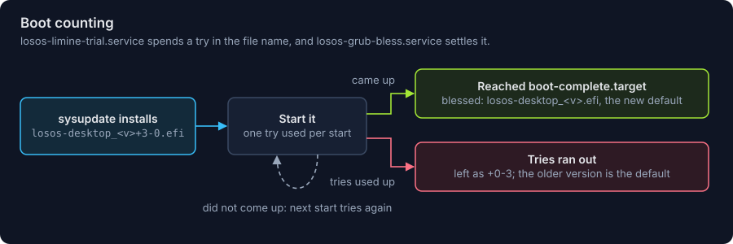

# Boot loader and boot screen

LosOS boots with [Limine](https://github.com/limine-bootloader/limine) on
every PC. On UEFI it starts from the ESP. On an x86_64 PC that starts by
legacy BIOS, or by UEFI's Compatibility Support Module with UEFI turned off,
it starts from the MBR. One disk carries both, so the same image, the same
install and the same updates start on either kind of firmware, and both hand
over to the same Plymouth splash. arm64 has no BIOS, so only the UEFI half
applies there.

```
UEFI   firmware -> ESP: Limine -> chainloads the newest UKI -> systemd-stub
BIOS   firmware -> MBR -> BIOS boot partition: Limine
              -> the newest UKI's kernel, initrd and command line
then   the systemd initrd, under Plymouth -> the login screen
```


Limine has no script language, so the menu is a plain `limine.conf` that
`losos-limine-menu` rewrites from the UKI file names on the disk (see
[The menu](#the-menu)). Under either firmware it lists the same versions, and
the two `/usr` slots and rollback work the same way on both.

## What it looks like

Limine draws its own menu. The `limine.conf` that `losos-limine-menu` writes
asks for:

- the salmon, `limine/salmon.png` on the ESP, centred
  (`wallpaper_style: centered`) on the dark ground (`backdrop: 0a0e12`);
- the terminal and interface colours of the same palette, with "LosOS
  Desktop" as the branding line at the top;
- a three-second countdown (`timeout: 3`);
- the menu on the serial port as well (`serial: yes`, at 115200 baud on a
  BIOS).

Each entry is listed by its name, which is the UKI's file name, and the line
under the menu shows the highlighted entry's comment, "LosOS Desktop
`<version>`". Limine's own help line offers the arrow keys, Enter to boot,
`E` to edit an entry, `B` for a blank entry and, on UEFI, `S` for the
firmware's setup.

> [!NOTE]
> There is no screenshot of the Limine menu here yet. Under QEMU with OVMF,
> the `limine.conf` above made Limine draw a plain text menu without the
> salmon or the colours. The same file without `serial: yes` drew the salmon
> and the colours.

The menu, the splash systemd-stub shows while the kernel loads, and the
Plymouth splash all come from one picture, `nixos/branding/salmon.png`. It
is the same coho salmon that LosOS itself boots behind, cut out of a NOAA
Fisheries photo, and `nixos/branding/CREDITS.md` credits it.
`nixos/branding/default.nix` makes every picture from it at build time, on
the dark palette that derisk and LosOS's WebUI share. Replace that one file
and all of them change.

- **Limine**'s wallpaper is `limine/salmon.png`, from the `limine/` output of
  `nixos/branding/default.nix`. That output also still has a `grub/`
  directory with the old GRUB theme's pieces, which nothing on the disk uses.
- **systemd-stub** shows the UKI's `.splash`, the salmon and the name on
  black, centred while the kernel and initrd load. That keeps the screen
  from going dark between the boot loader and Plymouth. `nixos/modules/splash.nix` sets
  it up.
- **Plymouth**, scripted in `nixos/branding/splash.script`, shows the salmon
  swimming in the middle of the screen, with "LosOS Desktop is starting"
  under it and a line that grows as the boot goes on. The swim is 16 frames
  drawn at build time from the same picture. A wave runs from head to tail,
  one stroke a second, and the fish rises and sinks a little. A password
  prompt or a question takes the caption's place. At shutdown the caption
  says "is restarting" or "is shutting down". Plymouth runs from the initrd
  until the login screen takes the display. Nothing on it appears abruptly.
  The screen fades in from the dark ground when Plymouth starts, the caption
  and a prompt cross-fade, and just before the login screen everything fades
  back to the ground except the line, which fills and stays. The login screen
  starts from that frame. It draws the same line in the same place and closes
  it into a dot that opens the screen, as the launch film shows. Esc shows
  the boot log.


The start has a sound too, the launch film's closing three seconds, which
are the two bars under its end card, in `nixos/branding/end-track.flac`. It
plays as soon as the kernel finds a sound card, while Plymouth still shows
the salmon. At shutdown or restart it plays backwards, after the sessions
and the login screen have closed, under Plymouth's "is shutting down"
screen. `nixos/modules/boot-sound.nix` does this. No PipeWire runs at either
moment, so the sound goes straight to ALSA's default card at whatever volume
the machine was left at. A machine without a sound card plays nothing.

> [!TIP]
> The kernel prints errors only (`loglevel=3`), systemd prints its status
> lines only when a unit fails or the boot stalls (`systemd.show_status=auto`),
> and Plymouth keeps even those behind Esc; every message is still in the
> journal.

The [installer ISO](installer.md) looks the same, but says "LosOS Desktop
installer". Halium phones boot through Android's boot loader and draw
nothing until the compositor starts, so none of this applies to them.

## What is on the disk

```
MBR boot code                       Limine's BIOS boot code (UEFI ignores it)
BIOS boot partition, 1 MiB          Limine's BIOS stage (x86_64 only)
ESP
  limine-bios.sys                   the rest of Limine for a BIOS (x86_64 only)
  limine.conf                       the menu
  limine/salmon.png                 the menu's wallpaper
  EFI/BOOT/BOOTX64.EFI              Limine (shim, with Secure Boot's key)
  EFI/BOOT/limine.conf              the same menu
  EFI/losos/grubx64.efi             Limine, where a boot entry can name it
  EFI/losos/limine.conf             the same menu
  EFI/losos/grubenv                 GRUB's old boot counter; Limine does not read it
  EFI/losos/installed               what losos-grub-update installed last
  EFI/Linux/losos-desktop_<v>.efi     the UKI, version <v>
  EFI/Linux/losos-desktop_<v>.linux   its kernel (x86_64 only)
  EFI/Linux/losos-desktop_<v>.initrd  its initrd (x86_64 only)
  EFI/Linux/losos-desktop_<v>.grub    its command line, as a line of GRUB script
```

Limine's EFI program sits under the name `grub<arch>.efi`, because that is
the file Microsoft-signed shim starts from beside itself (see [Secure
Boot](#secure-boot)). The `.grub` files keep their name from the GRUB days
too, and so does `losos-grub-update`. `nixos/modules/grub.nix` defines all
of it.

The image, `system.build.disk` in `image.nix`, and the
[installer ISO](installer.md) run `losos-limine-menu` on the finished disk.
It writes the menu, the wallpaper and, on x86_64 when the disk has a BIOS
boot partition, `limine-bios.sys` and Limine's BIOS boot code, with
`limine bios-install`. The [Windows installer](windows-installer.md) writes
a short `EFI/losos/limine.conf` of its own instead, because it only adds
LosOS beside Windows on a UEFI PC. The BIOS boot partition itself comes from
`nixos/modules/bios.nix`.

UEFI Limine chainloads the UKI, so systemd-stub runs as it would under any
loader. It measures the UKI into the TPM, shows its splash and starts the
kernel with the built-in command line. Limine sets the EFI variables
`LoaderInfo` and `LoaderDevicePartUUID`, as systemd-boot did, and
`systemd-gpt-auto-generator` reads them to find the root disk and mount the
ESP.

BIOS Limine cannot run a UKI, because a UKI is an EFI program. So every
x86_64 release also carries each UKI's kernel, initrd and command line as
separate files, cut from the finished UKI. sysupdate installs them beside the
UKI as part of the same version, through the transfers in `uki-files.nix`.
An aarch64 release carries only the `.grub` file, which Limine does not read
there. A BIOS entry's command line is the UKI's with two changes. systemd
finds the root partition from `LoaderDevicePartUUID`, and a BIOS has no EFI
variables, so `root=gpt-auto` becomes `root=/dev/disk/by-loader/root
losos.esp=<partition UUID of the ESP>`. A udev rule in the initrd links that
path to the partition labelled `root-x86-64` on the same disk as that ESP,
so a second LosOS disk in the machine is never mounted by mistake. The line
also ends in `losos.uki=<the UKI's file name>`, which tells
[boot counting](#boot-counting) which UKI started.
`systemd-gpt-auto-generator` mounts the root disk's ESP at `/efi` only under
UEFI, so a small generator in `bios.nix` does the same on a BIOS boot.

## Updating the boot loader

The Limine on a disk is the one the image or the installer put there, and
`/usr` carries the Limine its version was built with. After an update,
`losos-grub-update.service` copies the new one over the old, the way
`systemd-boot-update.service` does for systemd-boot. It is defined in
`grub.nix`. It runs after `losos-grub-bless`, so a version's boot loader
reaches the disk only after that version has started cleanly. It never goes
backwards: a rollback to an older version keeps the newer boot loader. It
writes each file beside the old one and renames it into place.
`EFI/losos/installed` records which version it installed last, so a boot
with nothing new writes nothing.

It always writes `EFI/losos/grub<arch>.efi`. `EFI/BOOT/BOOT<ARCH>.EFI` and
`EFI/systemd/systemd-boot<arch>.efi` are replaced only when they already
hold LosOS's Limine, the GRUB an older install still starts, LosOS's
systemd-boot, or shim with one of those beside it. So on a disk the
[Windows installer](windows-installer.md) set up, `EFI/BOOT/BOOT<ARCH>.EFI`
stays Windows'. It puts an empty `grubenv` in place if there is none, then
rewrites the menu with `losos-limine-menu`. On x86_64, when the disk has a
BIOS boot partition, it also rewrites `limine-bios.sys` and Limine's BIOS
boot code. Any file it adds to a disk the Windows installer set up goes on
that installer's list, so uninstalling LosOS from Windows removes it as
well.

NixOS's own boot loader modules stay off (`boot.nix`), because this OS is
never rebuilt in place.

UEFI used to boot with systemd-boot and then with GRUB. A disk installed
before the switch keeps starting the loader it has until the first boot of a
version with Limine reaches `boot-complete.target`. Then
`losos-grub-update` puts Limine at every path that loader was started from.
While systemd-boot is what started the machine, `losos-grub-bless` and
`losos-limine-trial` leave the boot to systemd-boot's own tools.

## The menu

`losos-limine-menu` (`nixos/modules/limine-menu.sh`) writes the menu. It
runs on the disk when the image and the installer write it, at every boot
and shutdown through `losos-limine-menu.service`, and after
`losos-grub-update`. It looks for `EFI/Linux/losos-desktop_*.efi` on the ESP
and, where there is one, the XBOOTLDR partition, and writes one entry for
each UKI:

1. the UKIs with tries left, or with no count at all, newest version first;
   the first entry is the one Limine starts when the countdown ends;
2. after them, any that used up their tries, with "(failed to start)" in
   their comment;
3. on UEFI, Windows Boot Manager when it is on the ESP.

Each UKI gets a UEFI entry, which chainloads it, and on x86_64, when its
kernel and `.grub` file are beside it, a BIOS entry, which starts that
kernel and initrd with the command line described above. `if_fw_type` makes
Limine show only the entries for the firmware it is running on. The same
file is written to `limine.conf`, `EFI/BOOT/limine.conf` and
`EFI/losos/limine.conf`.

The menu's editor is on (`editor_enabled: yes`). `E` opens the highlighted
entry's lines, `protocol`, `path` and, on a BIOS entry, `cmdline`, and
F10 or Ctrl+X starts the edited entry for that one boot. A UEFI entry has no
command line of its own: it starts the UKI with the one built into it.

## Boot counting

sysupdate installs a UKI with three tries in its name,
`losos-desktop_<v>+3-0.efi`, as `update.nix` sets up. Limine cannot rename a
file or keep a count, so userspace keeps it in the file name:

- `losos-limine-trial.service` spends one try as soon as the ESP can be
  seen. It renames the UKI that started, `+3-0` to `+2-1` and so on. A
  kernel that dies before this runs is started again with the same count.
- `losos-grub-bless.service` is the other half. Like
  `systemd-bless-boot.service`, it is ordered after `boot-complete.target`.
  It renames the version that started to `losos-desktop_<v>.efi`, which
  counts as blessed.
- A UKI that runs out of tries keeps the name `losos-desktop_<v>+0-3.efi`,
  the name systemd-boot gives an entry that used up its tries. The menu puts
  it after the others, so the older version is the default again.



Both find the UKI that started from the EFI variable `LoaderEntrySelected`
on UEFI, where the menu names each entry after its UKI's file, or from
`losos.uki=` on a BIOS boot's command line. `losos-grub-bless` also empties `grubenv`, which Limine does not read.
Nothing reads the one-shot request older versions kept there.

## The installer ISO

The [installer ISO](installer.md) starts with Limine too, with the same
colours and wallpaper. On UEFI, its appended FAT partition holds Limine as
the removable-media boot path, with the installer's UKI, its kernel and
initrd, and a menu with two entries: **Install LosOS Desktop**, which
chainloads the UKI, and **Try LosOS Desktop**, which starts the kernel and
initrd with the UKI's command line and `losos.try=1`. On an x86_64 BIOS,
Limine's CD boot image starts it from a disc or a USB stick, and reads a
menu of its own with the same two entries, both starting the kernel and
initrd from `boot/` on the ISO 9660 filesystem. Plymouth then shows "LosOS
Desktop installer is starting" until the installer takes the screen.
`nixos/installer/iso.nix` builds it.

## Secure Boot

A release signed with LosOS's key starts with Secure Boot on.
Microsoft-signed shim goes in front of Limine on the ESP, Limine and every
UKI are signed, and the key is enrolled once in shim's MokManager. [Secure
Boot](secure-boot.md) has the details, and how to enroll the key. Secure Boot
is UEFI's and does not apply to a BIOS boot.

> [!IMPORTANT]
> An image built without the key, such as a fork's or a local build's, has
> Limine alone on the ESP, unsigned, and starts only with Secure Boot off.

## Tested

`nix flake check` boots the image under UEFI in `checks.x86_64-linux.boot`
and checks that `LoaderInfo` names Limine. The test then renames the UKI to
the name sysupdate gives a new one, reboots, and checks that the file was
blessed. It also checks that `losos-grub-update` replaces an older boot
loader and that `losos-boot-order` puts LosOS's firmware entry first again.
`boot-bios` boots the same image under QEMU's SeaBIOS and checks the ESP
mount without EFI variables, the BIOS boot code an update rewrites, boot
counting, and that root still comes from the disk the boot started from when
a second disk carries a root partition labelled as LosOS's.
`installer-boot` and `installer-boot-bios` start the installer ISO under
each firmware. `secure-boot` boots the image with Secure Boot on ([Secure
Boot](secure-boot.md#tested)).

> [!NOTE]
> These tests were written for GRUB. Their check of `LoaderInfo` names
> Limine, but some steps still look at GRUB-era files such as `grubenv`.
