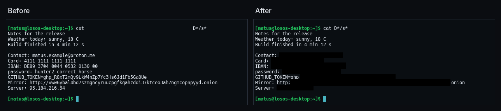

# Screenshots

Print takes a screenshot of the whole screen and saves it in
`Pictures/Screenshots`. Apps take one through the portal, and agents through
derisk's `screenshot` tool. Before any of these pictures is encoded, derisk
blacks out the secrets in it, so they never reach a file, an app or a
language model. This is on by default. Settings, Privacy, Screenshots turns
it off.

## What is blacked out

| Kind | How it is found |
| --- | --- |
| Passwords | Password fields in the accessibility tree, whatever they show, and the value after a label such as `Password:`, `PIN:` or `passphrase =` |
| Keys and tokens | Their prefixes (GitHub, GitLab, Slack, Stripe, AWS, Google, `sk-`), JSON web tokens, the value after `TOKEN=`, `API key:` or `secret:`, and any run of letters and digits random enough to be one, which covers private keys' bodies |
| Card numbers | 13 to 19 digits that pass the Luhn check, or four groups of four digits however OCR read them |
| IBANs | A country code, check digits and the rest, when the mod 97 check passes |
| Email addresses | Any `name@domain.tld` |
| Phone numbers | `+`, a country code and 8 to 15 digits |
| Onion addresses | Version 3 and version 2 `.onion` names, even with a few characters misread |
| Wallet addresses | Bitcoin bech32 and Ethereum addresses, and Monero and legacy Bitcoin addresses by their randomness |
| IP addresses | Public IPv4 and IPv6 addresses. Private, loopback and link-local ones say nothing about anyone and stay |
| Windows | Password managers' and authenticators' windows, whole: KeePassXC, Bitwarden, 1Password, Proton Pass, Secrets, Passwords and Keys, KWallet Manager, Authenticator |

Words, file names, paths, dates, version numbers, Nix store hashes, UUIDs
and Git commit hashes are left alone.

## How it works

`derisk-redact`, a crate in derisk, does the finding. It works from three
sources.

1. **The screen's text.** [ocrs](https://github.com/robertknight/ocrs), a
   pure-Rust OCR engine, reads every line of the screenshot. Patterns find
   the secrets in each line, and each secret's own characters give the box
   to black out. The patterns forgive what OCR gets wrong. An underscore read
   as a space, an `@` read as a letter, or a `?` for a character it could not
   read still matches.
2. **The accessibility tree's password fields.** derisk asks the
   compositor for the tree in the same frame as the screenshot. Password
   fields are blacked out whatever they show, and so are the windows of the
   apps listed above.
3. **The tree's other text.** Every element's name and value is checked with
   the same patterns. This text needs no reading, so OCR cannot misread it.
   A small element with a secret goes black whole. A large one, such as a
   document, goes black only where OCR found the secret, unless OCR found
   nothing there.

Reading a 1080p screen takes a second or two. derisk does it on the thread
that encodes the picture, so the desktop never waits. The notification for
a Print screenshot says what was blacked out, such as "Blacked out 2 emails
and 1 key". An agent's result says it in `redacted`.

## The OCR models

ocrs reads with two models, `text-detection.onnx`, which finds the words,
and `text-recognition.onnx`, which reads each line. Together they are about
12 MB. `nixos/pkgs/derisk.nix` fetches them by hash and installs them in
derisk's `share/derisk/ocr`, where derisk finds them beside its `bin`.
`$DERISK_OCR_MODELS` names another directory. derisk loads them the first
time a screenshot needs them and keeps them.

> [!WARNING]
> Without the models, derisk can only black out what the accessibility tree
> knows about: password fields, password managers and the text of derisk's
> own apps. The notification then says the text could not be read. Check
> such a screenshot before you share it.

## Limits

Redaction finds secrets by their look, so it cannot know everything that is
private. A name, a street address, a face or a password typed into a text
editor with no label beside it stays visible. Text drawn too small, rotated
or over a busy picture may not be read. The boxes cover what was found and
nothing more, so look over a screenshot before you post it anywhere public.

Screen sharing and recording go through xdg-desktop-portal-wlr, not
derisk's screenshot path, and are not redacted.
