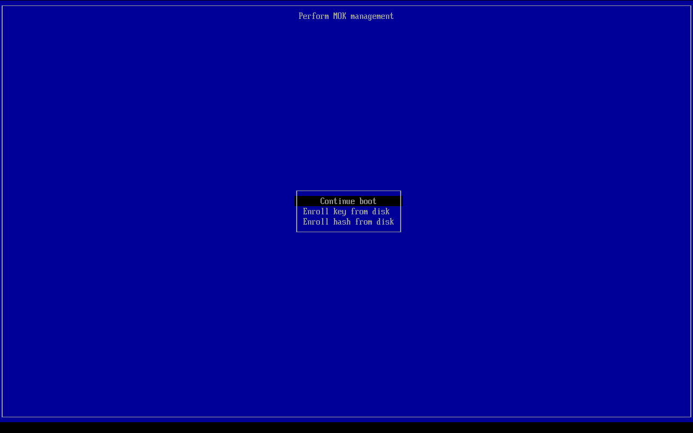
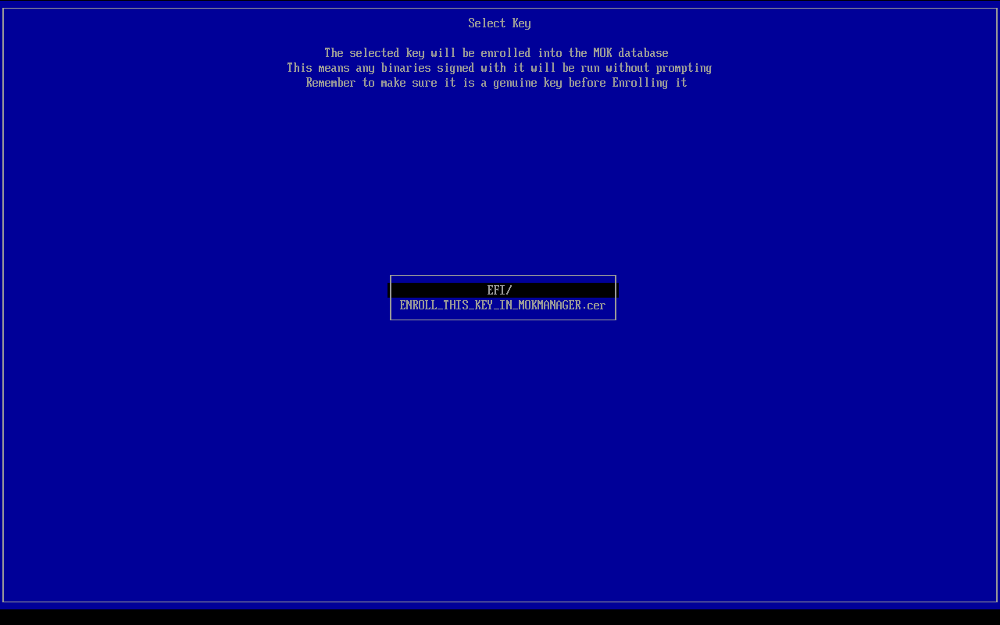

# Secure Boot

A release signed with LosOS's key starts on a PC with Secure Boot on. The
firmware keeps the keys it came with. Once, at the first boot with Secure
Boot on, someone at the machine adds LosOS's certificate to the machine's
list of owner keys, the MOK list. After that, the firmware and shim start
nothing that key did not sign.

```
UEFI  firmware (Microsoft's keys) -> ESP: shim, signed by Microsoft
        -> GRUB, signed with LosOS's key, checked against the MOK list
        -> the UKI, signed with LosOS's key, checked by shim the same way
        -> systemd-stub -> the kernel and initrd inside the UKI
```

Settings' [security report](security-report.md) counts Secure Boot as passed
once the firmware says it is on. A BIOS boot has no Secure Boot, and the
[boot loader](boot-loaders.md) page describes everything that is the same
with or without it.

## Enrolling LosOS's key

The first time a PC with Secure Boot on starts LosOS, from an installed disk
or from the [installer ISO](installer.md), shim cannot check GRUB yet and
says so:

1. "Verification failed: (0x1A) Security Violation" shows. Press Enter.
2. "Shim UEFI key management" shows for ten seconds. Press any key before it
   is gone. If it goes, the PC restarts and shows it again.
3. Choose **Enroll key from disk**.

   

4. Choose the ESP, the volume LosOS boots from. Its top level lists
   `ENROLL_THIS_KEY_IN_MOKMANAGER.cer`. Choose it.

   

5. Choose **Continue**, then **Yes** to enroll the key, then **Reboot**.

GRUB's menu shows next, and LosOS starts. The key stays in the firmware's
memory, so the installed system starts too if the key was enrolled from the
installer, and every later update starts without asking again.

> [!WARNING]
> Enroll a certificate only from a LosOS medium you trust. MokManager trusts
> whatever certificate is chosen, and a certificate from someone else lets
> their boot code start on this PC as LosOS's does.

To check, `od -An -tu1 -j4 -N1
/sys/firmware/efi/efivars/SecureBoot-8be4df61-93ca-11d2-aa0d-00e098032b8c`
prints `1` with Secure Boot on, and `journalctl -k -b | grep "LosOS Desktop
Secure Boot"` shows the kernel loading LosOS's certificate from the MOK list.

## What is on the ESP

`nixos/modules/shim.nix` lays it out, and the image, the installer ISO and
[every update](releases.md) put the same files there:

| File | What it is |
| --- | --- |
| `EFI/BOOT/BOOTX64.EFI` (`BOOTAA64.EFI` on arm64) | shim, at the path firmware starts with no boot entry |
| `EFI/BOOT/grubx64.efi` | GRUB, signed with LosOS's key, which shim starts |
| `EFI/BOOT/mmx64.efi` | MokManager, which shim starts when GRUB fails its check |
| `EFI/losos/shimx64.efi`, `grubx64.efi`, `mmx64.efi` | the same three, for a firmware entry of LosOS's own |
| `ENROLL_THIS_KEY_IN_MOKMANAGER.cer` | LosOS's certificate, in the DER form MokManager reads |

`losos-grub-update` writes them at the first boot of each version, as it
writes GRUB. It also puts shim in front of a GRUB or systemd-boot an older
install left at the removable-media path. A disk installed before signed
releases gets shim and the certificate with its first signed update, and
keeps starting with Secure Boot off until someone turns it on and enrolls
the key.

Without a key, as in a build from a fork or on a machine that has none, the
ESP holds GRUB alone at `EFI/BOOT/BOOTX64.EFI`, unsigned. Such an image
starts only with Secure Boot off.

## Where shim comes from

Only Microsoft can sign a shim that firmware trusts, and it signs a
distribution's shim only after the build passes
[shim-review](https://github.com/rhboot/shim-review). LosOS has not been
through that review, so it ships Fedora's signed shim 16.1, pinned by hash
from Fedora's build system (`nixos/pkgs/shim-signed.nix`). shim and
MokManager are copied out of Fedora's package unchanged, since changing a
byte would break Microsoft's signature.

- The x86_64 shim is signed by Microsoft's UEFI CA 2011 and its 2023
  successor, so firmware trusting either starts it.
- The arm64 shim is signed by the 2023 CA alone. An arm64 PC whose firmware
  trusts only the 2011 CA does not start it.
- shim carries Fedora's certificate as well as the MOK list, so on a
  machine that trusts Microsoft's third-party CA it also starts Fedora's own
  GRUB and kernels. That machine already starts any distribution's shim, so
  this adds nothing it did not already trust.

shim refuses a GRUB whose SBAT generation is older than its revocation list.
`nixos/modules/grub-image.nix` gives GRUB the `grub,5` generation, which
GRUB 2.14 qualifies for, and a `grub.losos` line LosOS would raise if it ever
had to revoke its own builds.

shim is BSD-licensed, and redistributing it in binary form needs this
notice:

```
Copyright 2012 Red Hat, Inc <mjg@redhat.com>

Redistribution and use in source and binary forms, with or without
modification, are permitted provided that the following conditions
are met:

Redistributions of source code must retain the above copyright
notice, this list of conditions and the following disclaimer.

Redistributions in binary form must reproduce the above copyright
notice, this list of conditions and the following disclaimer in the
documentation and/or other materials provided with the
distribution.

THIS SOFTWARE IS PROVIDED BY THE COPYRIGHT HOLDERS AND CONTRIBUTORS
"AS IS" AND ANY EXPRESS OR IMPLIED WARRANTIES, INCLUDING, BUT NOT
LIMITED TO, THE IMPLIED WARRANTIES OF MERCHANTABILITY AND FITNESS
FOR A PARTICULAR PURPOSE ARE DISCLAIMED. IN NO EVENT SHALL THE
COPYRIGHT HOLDER OR CONTRIBUTORS BE LIABLE FOR ANY DIRECT,
INDIRECT, INCIDENTAL, SPECIAL, EXEMPLARY, OR CONSEQUENTIAL DAMAGES
(INCLUDING, BUT NOT LIMITED TO, PROCUREMENT OF SUBSTITUTE GOODS OR
SERVICES; LOSS OF USE, DATA, OR PROFITS; OR BUSINESS INTERRUPTION)
HOWEVER CAUSED AND ON ANY THEORY OF LIABILITY, WHETHER IN CONTRACT,
STRICT LIABILITY, OR TORT (INCLUDING NEGLIGENCE OR OTHERWISE)
ARISING IN ANY WAY OUT OF THE USE OF THIS SOFTWARE, EVEN IF ADVISED
OF THE POSSIBILITY OF SUCH DAMAGE.

Significant portions of this code are derived from Tianocore
(http://tianocore.sf.net) and are Copyright 2009-2012 Intel
Corporation.
```

## The key

The certificate is committed at `nixos/keys/secure-boot.crt`, as the
[update key's](binary-cache.md) public half is, so a change to it shows in
review. The private key is never in the repository or the Nix store, which
anyone can read and the binary cache publishes. CI has it as the repository
secret `SECURE_BOOT_KEY`, and each build job writes it to a file only the
build users can read and points `LOSOS_SECURE_BOOT_KEY` at it. Only the
repository's owner can set that secret.

To make the pair, once, on a machine you trust:

```sh
openssl req -x509 -newkey rsa:2048 -sha256 -nodes -days 36500 \
  -subj "/CN=LosOS Desktop Secure Boot/" \
  -keyout secure-boot.key -out nixos/keys/secure-boot.crt
```

Then paste `secure-boot.key` into the `SECURE_BOOT_KEY` secret, keep a copy
offline, and commit `nixos/keys/secure-boot.crt`. A secret with no committed
certificate signs nothing, and CI says so in a notice. A committed
certificate with no secret fails CI's builds outside a pull request, because
those releases would ask people to enroll a key nothing was signed with.

The signing steps (`sign` in `nixos/modules/shim.nix`) are the only builds
that read the key. Each one reads it with no sandbox around it, checks that
it belongs to the certificate, and signs one file, GRUB or a UKI. So a
builder that signs needs `sandbox = relaxed` in `nix.conf` and the key
readable by the `nixbld` group, and the flake needs `--impure` to see the
variable:

```sh
LOSOS_SECURE_BOOT_KEY=/var/lib/losos-secure-boot/key.pem nix build --impure
```

Every other build stays sandboxed. Putting the key in `extra-sandbox-paths`
instead would show it to every build, fetchers with network access included.

> [!CAUTION]
> Anyone with the private key can make boot code that every PC which
> enrolled the certificate starts. Losing it means the next release has to be
> signed with a new key, and every PC has to enroll that one.

## While Secure Boot is on

- GRUB is locked down. It starts the UKI as signed and ignores
  `losos_extra`, so [the recovery
  shell](troubleshooting.md#no-one-can-administer-the-machine) needs Secure
  Boot turned off in the firmware first. The kernel beside the UKI is not
  signed, and its command line could not be checked if it were.
- systemd-stub uses only the command line built into the UKI. It already
  did, since GRUB never passes a UKI any arguments.
- The kernel's lockdown and module signing are as
  [kernel hardening](kernel-hardening.md) describes, with or without Secure
  Boot. Secure Boot adds that the next kernel is checked too.

## Tested

`checks.x86_64-linux.secure-boot` boots the image with OVMF's Microsoft
keys, Secure Boot on and a test key in the MOK list. It checks that the
firmware reports Secure Boot on, that the kernel loaded the test
certificate from the MOK list, that GRUB chainloaded the UKI, and that the
security report passes its Secure Boot check. The other boot tests use the
same signed layout with Secure Boot off, so `boot` also checks that an
update puts shim, GRUB and MokManager in place of an older GRUB or
systemd-boot.

MokManager's enrollment was walked through by hand under QEMU with the same
firmware and no key enrolled. shim refused GRUB, MokManager enrolled
`ENROLL_THIS_KEY_IN_MOKMANAGER.cer` from the ESP, and after the reboot GRUB
started its menu and the kernel reported Secure Boot on. The screenshots
above are from that run.
